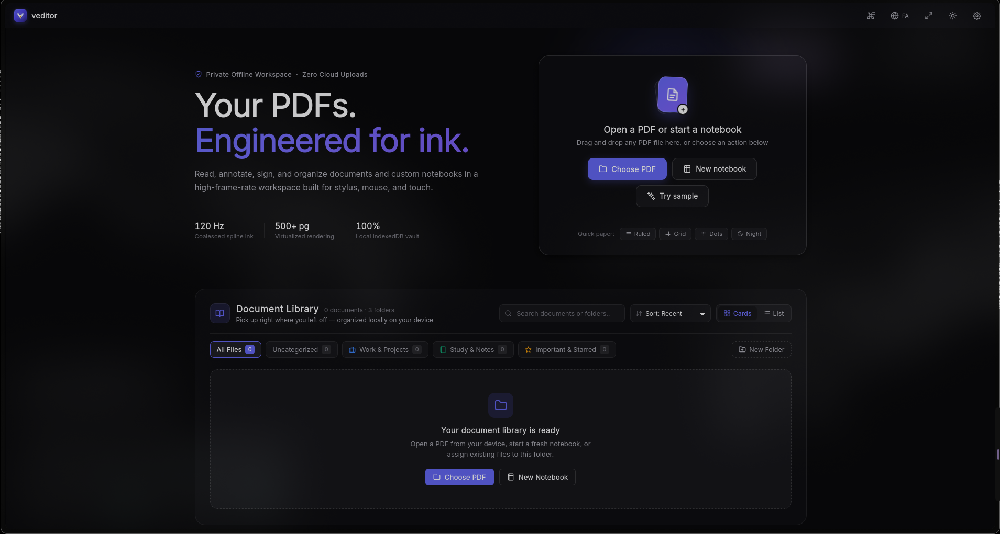
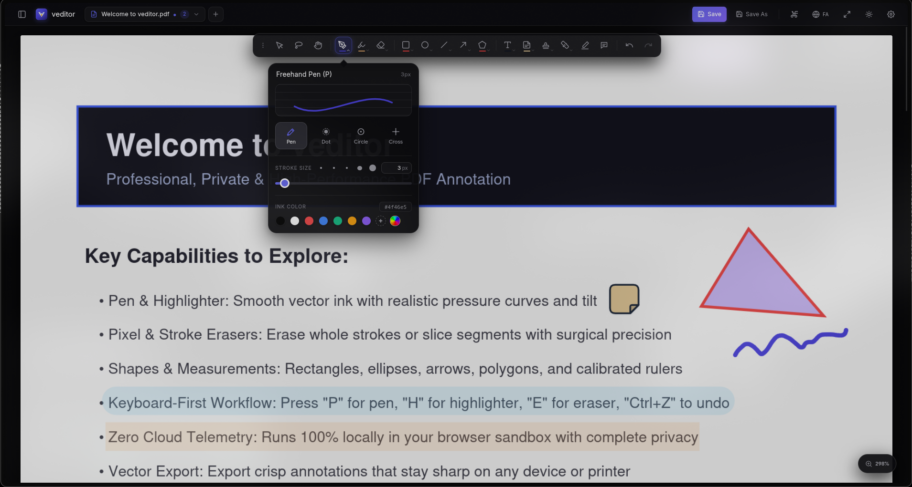
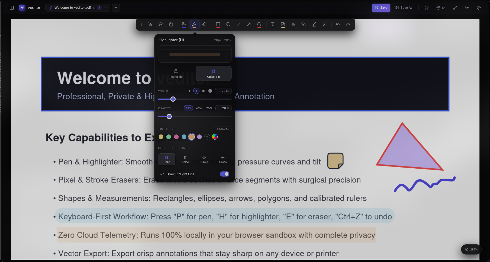
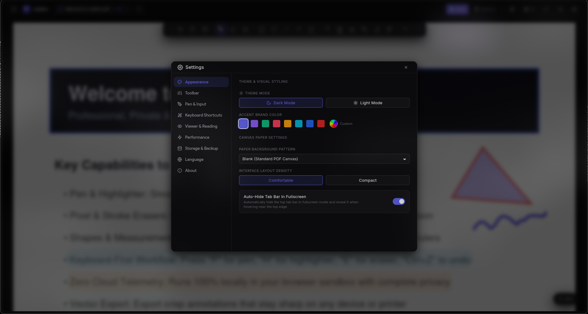

<div align="center">


# veditor

**High-Frame-Rate, Offline-First PDF Editor, Annotator & Digital Notebook**  
*Native Desktop App (Linux, Windows, macOS) & Browser Extension (Chrome, Brave, Edge, Firefox)*

[](https://github.com/v3ndettaaa/veditor/releases/latest)
[](https://appimage.github.io/veditor/)
[](https://github.com/v3ndettaaa/veditor/actions/workflows/release.yml)
[](#-development--testing)
[](#-privacy--security)
[-f59e0b?style=flat-square)](#-customization--localization)
[](LICENSE)

[**Download v4.0**](#-download--install) • [**Screenshots**](#-visual-showcase) • [**Features**](#-features) • [**Keyboard Shortcuts**](#%EF%B8%8F-keyboard-shortcuts) • [**Build from Source**](#-development--testing)

</div>

---

**veditor** is a fast, local-first workspace for reading, annotating, signing, and organizing PDF documents and custom notebooks. Built for 120Hz+ stylus input, mouse, and touch, it combines vector spline ink, true native PDF annotation embedding, and virtualized 500+ page rendering with **zero cloud uploads** and **zero telemetry**.

---

## 📸 Visual Showcase

### Private Offline Workspace & Document Library
Organize PDFs and custom notebooks locally with category folders, instant search, and one-click paper templates.



### 120Hz+ Freehand Ink & Vector Annotations
Pressure-sensitive spline ink, customizable brush cursors (*Pen*, *Dot*, *Circle*, *Crosshair*), sticky notes, and geometric shapes.



### Translucent Chisel & Round-Tip Highlighter
Non-destructive alpha-blended highlighting with chisel or round tips, custom tint swatches, and straight-line snap.



### Deep Customization & Preferences Hub
Dark/Light themes, custom brand accents, paper patterns, fullscreen auto-hide tab bar, DPI scaling, and full English / Persian (`فارسی`) localization.



---

## 📥 Download & Install

All official desktop installers and browser extension packages are built automatically via GitHub Actions and published on the [**GitHub Releases**](https://github.com/v3ndettaaa/veditor/releases/latest) page. You can also check for new versions manually at any time from **Settings → About → Check for Updates**.

### Desktop Application (Tauri v2)

| Platform | Architecture | Format | Download Link |
| :--- | :--- | :--- | :--- |
| **Linux** *(Arch, Ubuntu, Fedora)* | `x86_64` | `PKGBUILD` / `.AppImage` / `.deb` / `.rpm` | [**Download for Linux (v4.0.0)**](https://github.com/v3ndettaaa/veditor/releases/latest) |
| **Windows** *(10 / 11)* | `x86_64` | `.exe` Setup / `WinGet` / `Scoop` | [**Download for Windows (v4.0.0)**](https://github.com/v3ndettaaa/veditor/releases/latest) |
| **macOS** *(Apple Silicon)* | `aarch64` (`M1–M4`) | `.dmg` / `Homebrew` | [**Download for macOS ARM64 (v4.0.0)**](https://github.com/v3ndettaaa/veditor/releases/latest) |
| **macOS** *(Intel)* | `x86_64` | `.dmg` / `Homebrew` | [**Download for macOS Intel (v4.0.0)**](https://github.com/v3ndettaaa/veditor/releases/latest) |

### Browser Extensions

| Browser | Format | Direct Download |
| :--- | :--- | :--- |
| **Chrome / Brave / Edge** *(Manifest V3)* | `.zip` | [**veditor-chrome.zip**](https://github.com/v3ndettaaa/veditor/releases/latest/download/veditor-chrome.zip) |
| **Firefox** *(WebExtensions)* | `.zip` | [**veditor-firefox.zip**](https://github.com/v3ndettaaa/veditor/releases/latest/download/veditor-firefox.zip) |

<details open>
<summary><strong>🐧 Linux Installation Commands (Arch / Ubuntu / Fedora / AppImage)</strong></summary>

- **Arch Linux / Manjaro / EndeavourOS (`PKGBUILD` via `makepkg`)**:
  ```bash
  curl -fsSLO https://raw.githubusercontent.com/v3ndettaaa/veditor/main/packaging/aur/PKGBUILD
  makepkg -si
  ```
- **Debian / Ubuntu / Linux Mint / Pop!_OS (`.deb`)**:
  ```bash
  curl -LO https://github.com/v3ndettaaa/veditor/releases/latest/download/veditor_4.0.0_amd64.deb
  sudo apt install ./veditor_4.0.0_amd64.deb
  ```
- **Fedora / RHEL / openSUSE (`.rpm`)**:
  ```bash
  sudo dnf install https://github.com/v3ndettaaa/veditor/releases/latest/download/veditor-4.0.0-1.x86_64.rpm
  ```
- **Official AppImage Catalog / AM Package Manager (Any Linux Distro)**:
  ```bash
  # Install via AM / AppMan from the official AppImage Catalog (https://appimage.github.io/veditor/):
  am -i veditor
  # or run the portable AppImage directly:
  curl -LO https://github.com/v3ndettaaa/veditor/releases/latest/download/veditor_4.0.0_amd64.AppImage
  chmod +x veditor_4.0.0_amd64.AppImage
  ./veditor_4.0.0_amd64.AppImage
  ```
  *Note: Automatically configures WebKitGTK (`WEBKIT_DISABLE_DMABUF_RENDERER=1`) and host Mesa GPU driver compatibility on rolling-release distributions such as Arch Linux.*
</details>

<details>
<summary><strong>🪟 Windows & 🍎 macOS Package Manager Manifests</strong></summary>

- **Windows (Scoop & WinGet local manifests)**:
  ```powershell
  # Install via Scoop manifest from repo:
  scoop install https://raw.githubusercontent.com/v3ndettaaa/veditor/main/packaging/scoop/veditor.json

  # Install via WinGet manifest from repo:
  winget install --manifest .\packaging\winget\v3ndettaaa.VEditor.yaml
  ```
- **macOS (Homebrew Cask from repo)**:
  ```bash
  brew install --cask https://raw.githubusercontent.com/v3ndettaaa/veditor/main/packaging/homebrew/veditor.rb
  ```
</details>

<details>
<summary><strong>🌐 Browser Extension Installation Steps</strong></summary>

- **Chrome / Brave / Edge**:
  1. Download and extract [`veditor-chrome.zip`](https://github.com/v3ndettaaa/veditor/releases/latest/download/veditor-chrome.zip).
  2. Open `chrome://extensions` and enable **Developer mode**.
  3. Click **Load unpacked** and select the extracted folder.
- **Firefox**:
  1. Download [`veditor-firefox.zip`](https://github.com/v3ndettaaa/veditor/releases/latest/download/veditor-firefox.zip).
  2. Open `about:debugging#/runtime/this-firefox` → **Load Temporary Add-on...** and select the archive or `manifest.json`.
</details>

---

## ✨ Features

### 🖊️ Precision Digital Ink & Stylus Engine
- **120Hz+ Coalesced Spline Ink**: Centripetal Catmull-Rom spline interpolation produces smooth, organic curves with sub-millisecond visual feedback.
- **Hardware Stylus Pressure & Tilt**: Native pressure sensitivity for graphics tablets and active pens with configurable response curves (*Linear*, *Soft*, *Firm*, *Exponential*), plus optional palm rejection and hardware tail-eraser switching.
- **Draw-and-Hold Shape Recognition**: Sketch a rough line, arrow, rectangle, triangle, or ellipse and pause briefly at the end of the stroke to snap it into a clean geometric vector.
- **Advanced Highlighter**: Choose between **Round Tip** and **Chisel Tip** markers, customize opacity and tint swatches, or hold `Shift` (or enable *Draw Straight Line*) for horizontal/vertical text-aligned highlights.

### 📐 Complete Vector Annotation Suite
- **Flexible Geometric Shapes**: Rectangles (`R`), Ellipses (`O`), Lines (`L`), Arrows (`A`), and Multi-Point Polygons (`G`). Dragging a rectangle's corner moves that vertex independently; holding `Shift` scales the rectangle proportionally.
- **Rich Text & Sticky Notes**: Multi-line text boxes (`T`) and collapsible sticky notes (`S`) with full Unicode and bidirectional Persian (`فارسی`) vector glyph embedding.
- **3-Mode Eraser (`E`)**: Switch between **Stroke Eraser** (whole-stroke removal), **Pixel/Segment Slicer** (splits ink paths cleanly at intersections), and **Object Eraser**.
- **Signatures, Stamps & Clipboard Paste**: Draw and save vector signatures (`K`), place vector status stamps (`M`), or press `Ctrl+V` to paste any image directly from your system clipboard onto the page.

### 📄 Native PDF Compatibility, Page Operations & Interactive Links
- **Standard PDF Annotation Embedding**: Saved PDFs embed standard `/Ink`, `/Square`, `/Circle`, `/Polygon`, `/Line`, `/FreeText`, and `/Text` annotations so your work is visible in external PDF viewers.
- **Lossless Round-Trip Editing**: Re-opening a saved PDF in **veditor** automatically restores all vector strokes, shapes, text boxes, and sticky notes as fully editable objects without duplicate ghost layers.
- **Interactive PDF Links & Jump-Back History (`Alt + ←`)**: Click internal Table-of-Contents entries, footnotes, cross-references, and external URLs directly on the page when using the `Select` or `Hand` tool, then jump right back to your exact previous scroll position with the floating **`↩ Back to Page X`** pill or `Alt + Left Arrow`.
- **Merge, Extract & Non-Destructive Crop**: Drag and drop external `.pdf` files directly into the thumbnail sidebar at 60fps to merge pages at any position with full Undo/Redo support, extract selected pages into a standalone PDF, or interactively crop page margins (**Current Page**, **All Pages**, or **Custom Page Range**) while keeping annotations aligned and allowing one-click reset to original page bounds.

### ⚡ High-Performance Virtualized Viewport
- **500+ Page Virtualization**: Only on-screen and nearby preload pages occupy GPU memory; off-screen canvases are automatically recycled.
- **Two-Phase Live Zoom**: Trackpad pinch and `Ctrl + Scroll` scale smoothly at 60/120fps on the compositor and commit crisp high-DPI rasters once settled.
- **Multi-Tab Workspace**: Open multiple documents side by side with isolated per-tab Undo/Redo history stacks and instant `<1ms` tab switching.

### 🌐 Customization & Localization
- **Adaptive UI**: Dark and Light modes, 8 brand accent presets + custom color picker, Comfortable/Compact density, rebindable toolbar order, and optional **Auto-Hide Tab Bar in Fullscreen**.
- **Bilingual & Full RTL**: Instant switch between **English** and **Persian (`فارسی`)** with full Right-to-Left layout mirroring and bundled **Vazirmatn** + **Inter** typography.

---

## ⌨️ Keyboard Shortcuts

Every tool shortcut can be customized in **Settings → Keyboard Shortcuts**.

| Shortcut | Action | Shortcut | Action |
| :---: | :--- | :---: | :--- |
| `V` | Select & Transform | `A` | Arrow Tool |
| `Q` | Freehand Lasso Select | `G` | Multi-Point Polygon |
| `P` | Freehand Pen | `T` | Rich Text Box |
| `H` | Highlighter | `S` | Sticky Note |
| `E` | Eraser | `M` | Vector Stamp |
| `R` | Rectangle / Quad | `K` | Digital Signature |
| `O` | Ellipse / Circle | `N` | Floating Scratchpad |
| `L` | Straight Line | `Space` *(hold)* | Temporary Hand Pan |
| `Ctrl + Z` / `Ctrl + Y` | Undo / Redo | `Ctrl + S` | Save PDF |
| `Ctrl + +` / `Ctrl + -` | Zoom In / Out | `Ctrl + 0` | Fit to Width |
| `Alt + ←` | Jump Back to Previous Page | `Ctrl + K` | Command Palette |
| `?` | Keyboard Shortcuts Help | `F11` | Toggle Fullscreen |

---

## 🛠️ Development & Testing

### Prerequisites
- **Node.js** `>= 20` and **npm**
- **Rust** stable toolchain *(only required for building the Tauri v2 desktop app)*

### Commands

```bash
# Install dependencies
npm install

# Start local development server (http://localhost:3000)
npm run dev

# Run the automated Vitest suite (21 test suites, 187 tests)
npm test

# Type-check with TypeScript
npm run lint

# Build browser extensions
npm run build:chrome     # Outputs Chrome MV3 unpacked extension to dist/chrome
npm run build:firefox    # Outputs Firefox extension to dist/firefox
npm run package          # Packages dist/veditor-chrome.zip & dist/veditor-firefox.zip

# Build native desktop app (Tauri v2)
npm run build:desktop    # Builds frontend bundle to dist/desktop
npx tauri build          # Compiles native OS installers in src-tauri/target/release/bundle/
```

---

## 📁 Project Structure

```text
veditor/
├── docs/screenshots/          # Lossless showcase screenshots for documentation
├── packaging/                 # Arch AUR (PKGBUILD), WinGet, Scoop & Homebrew Cask manifests
├── public/                    # Extension icons & bundled offline PDF.js worker
├── src/
│   ├── annotations/           # Vector rendering engine, spline math, selection & tools
│   ├── background/            # Browser extension service worker
│   ├── core/                  # State store, PDF engine, native PDF ink/annot parser, history
│   ├── input/                 # 120Hz+ pointer pipeline, pressure curves, gestures & shortcuts
│   ├── io/                    # Native filesystem I/O, IndexedDB vault & vector PDF export
│   ├── ui/                    # Components, themes, custom cursors & EN/FA (RTL) i18n
│   └── main.ts                # Application bootstrap & virtualized viewport lifecycle
├── src-tauri/                 # Tauri v2 Rust desktop backend & Linux WebKitGTK tuning
├── tests/                     # 21 Vitest unit & integration test suites (187 tests)
├── manifest.chrome.json       # Chrome / Edge / Brave Manifest V3 config
└── manifest.firefox.json      # Firefox WebExtensions manifest config
```

---

## 🔒 Privacy & Security

- **100% Local Execution**: All PDF parsing, font rendering, and vector exports run locally on your device.
- **Zero Telemetry**: No analytics scripts, no external network calls, and no cloud accounts required.

---

## 📄 License

Released under the [MIT License](LICENSE).  
Found a bug or have a feature request? Open an issue on [GitHub](https://github.com/v3ndettaaa/veditor/issues).
